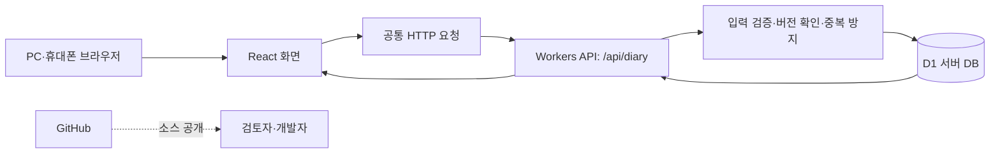

# 플랜두씨 다이어리 · PDS diary

**계획하고, 실제로 한 일을 기록하고, 돌아본 내용을 다음 계획으로 이어가는 학습 다이어리입니다.**

[실행 사이트](https://pds-study-planner.bronzeamber32.chatgpt.site/) · [소스 코드](https://github.com/eldi96/T06_plan-do-see-diary)

할 일에 체크하는 것에서 끝나지 않고, 계획과 실제 행동의 차이를 확인하는 데 초점을 맞췄습니다. 계획을 세부 할 일로 나누고, 달력에서 실행을 기록하며, 돌아보기에서 집계의 근거와 다음에 바꿀 점을 확인할 수 있습니다.

> 현재는 로그인과 사용자별 권한이 없는 공개 과제 버전입니다. 링크를 아는 누구나 자료를 보고 수정·삭제할 수 있습니다. 민감한 정보는 입력하지 마세요.

## 사용 흐름

1. **계획과 루틴**에서 기간·성공 기준·우선순위·예상시간을 정하고 할 일을 추가합니다.
2. **오늘 할 일** 또는 **실행 기록** 달력에서 할 일을 선택하고, 실제 소요시간과 함께 완료를 기록합니다.
3. **돌아보기**에서 완료·지연·막힘과 예상·실제시간을 확인하고, 고칠 점을 다음 계획으로 넘깁니다.

## 주요 기능

| 화면·기능 | 하는 일 |
|---|---|
| 오늘 할 일 | 할 일 검색·필터·정렬, 상태별 보기, 요약과 최근 실행 확인 |
| 계획과 루틴 | 계획·할 일 생성/수정/삭제, 계획 수정 이력, 요일별 반복 설정 |
| 계획 목록 | 페이지당 최대 12개, 1~6개는 넓은 카드·7~12개는 두 열 배치, 레이아웃 전환 |
| 실행 기록 | 월 달력과 날짜별 할 일, 완료 정도를 색으로 표시, 날짜 선택 시 상세 패널 |
| 간편 완료 | 실제시간 선택·직접 입력, 종료 시각과 막힌 이유, 완료와 실행 동시 저장 |
| 돌아보기 | 계획별·기간별 완료/지연/막힘/시간 집계, 숫자 클릭으로 근거 확인, 고칠 점 저장 |
| 월별 그래프 | 상단 예정량 곡선과 하단 완료율 막대, 날짜별 상세와 툴팁 |
| 시험 일정 | SQLD·ADsP 시험일, 7일 전·14일 전·직접 지정 공부 시작일 |
| 데이터 내보내기 | 기록·수정 이력·완료 이력을 JSON 파일 하나로 다운로드 |

### 기록과 집계 기준

- 계획과 할 일의 예상시간은 실제 실행 기록으로 덮어쓰지 않습니다.
- 실제시간은 사용자가 입력한 시간으로 계산합니다. 자동 학습시간 측정 기능은 아닙니다.
- 완료를 취소해도 과거 실행 기록은 남습니다.
- 지연은 서울 날짜 기준으로 마감일이 지난 미완료 할 일입니다.
- 막힘은 같은 할 일의 여러 실행에 이유가 있어도 할 일 하나로 셉니다.
- 삭제한 항목은 화면·집계에서 제외하며, 이력·내보내기를 위해 보존될 수 있습니다.
- 그래프의 곡선과 막대는 **서로 다른 높이 척도**입니다. 곡선은 상대적인 예정량, 막대는 0~100% 완료율이며 정확한 개수는 툴팁에서 확인합니다.
- 그래프는 할 일의 예정일과 현재 완료 상태를 기준으로 합니다. 과거 시점의 상태를 고정한 스냅샷은 아닙니다.

## 기술 구성

| 구분 | 사용 기술 |
|---|---|
| 화면 | React 19, TypeScript, Next App Router 형식 |
| 개발·빌드 | Vinext, Vite, npm |
| 스타일·아이콘 | CSS, Tailwind CSS, Lucide React |
| 인터랙션 | Anime.js 레이아웃 모션, CSS 전환, Motion |
| 차트 | Bklit 기반 차트 소스, Visx, D3 |
| 서버 | Cloudflare Workers, Zod 입력 검증 |
| DB | Cloudflare D1, Drizzle 스키마·SQL 마이그레이션 |
| 배포 | ChatGPT Sites |

서버 API의 핵심 저장은 D1의 준비된 SQL과 `batch`를 사용합니다. 스키마·마이그레이션 구성과 실제 API의 직접 SQL 처리를 함께 사용합니다.

## 시스템 구조



GitHub에는 소스를 보관하고, 실행 사이트와 서버 DB는 Sites 배포 환경에서 운영합니다. GitHub Pages로 배포한 앱이 아닙니다. GitHub에 코드를 올리는 작업과 사이트를 갱신하는 배포는 별개입니다.

### 데이터와 저장 안전성

`records`는 계획·할 일·실행·루틴·시험·돌아보기를 `kind`와 JSON 데이터로 구분합니다. `history`는 수정 전 값, `completions`는 완료 회차, `requests`는 처리한 요청을 보관합니다.

동일 요청 ID 재시도는 기존 결과를 반환하고, 레코드 버전으로 동시 수정 충돌을 확인합니다. 완료 회차의 고유 제약과 DB 검증 장치를 이용해 완료·실행·이력 저장이 부분적으로 성공하지 않도록 처리합니다.

최종 항목·관계·날짜 정책: [데이터 계약](app/contracts/pds-schema-v2.json) · [DB 마이그레이션](app/drizzle/)

## 주요 파일

```text
app/
├─ app/
│  ├─ page.tsx                    # 탭·화면·입력 폼 연결
│  ├─ layout.tsx                  # 공통 레이아웃·스타일 연결
│  ├─ api/diary/route.ts          # 조회·저장·완료·삭제·내보내기
│  └─ *.css                      # 화면별 스타일
├─ components/
│  ├─ plan-browser.tsx           # 계획 목록
│  ├─ execution-calendar.tsx     # 달력·날짜 상세
│  ├─ complete-task-dialog.tsx   # 실제시간·완료 기록
│  ├─ monthly-chart.tsx          # 월별 그래프
│  ├─ planned-progress-bands.tsx # 곡선·막대 표현
│  └─ charts/                    # 차트 기반 소스
├─ domain/                      # 타입·날짜·집계·검증
├─ hooks/                       # 계획 레이아웃 모션
├─ lib/diary-client.ts           # 공통 API 요청
├─ db/                          # DB 스키마·연결
├─ drizzle/                     # SQL 마이그레이션
├─ contracts/                   # 데이터 계약
├─ public/                      # 이미지·아이콘
├─ scripts/                     # 설치·빌드·실행에 필요한 도구
├─ build/                       # 빌드·런타임 연동 소스
├─ vendor/                      # 유지한 스타일·라이선스
├─ vite.config.ts
└─ package.json
```

`build/`는 유지해야 하는 빌드 연동 소스이며, 생성 결과물인 `dist/`와 다릅니다. 과제 내부 문서·테스트·개발 기록은 최신 공개 소스에서 제외했습니다. 기존 Git 이력은 재작성하지 않았습니다.

## 로컬 설치와 실행

필요 환경: **Node.js 22.13 이상**, npm, Git.

```sh
git clone https://github.com/eldi96/T06_plan-do-see-diary.git
cd plan-do-see-diary/app
npm ci
npm run build
```

처음 실행하는 환경은 로컬 DB 테이블을 준비합니다. 로컬 데이터만 대상으로 하는 명령입니다.

```sh
npx wrangler d1 migrations apply DB --local --config dist/server/wrangler.json --persist-to .wrangler/state
npm start -- --port 8787
```

로컬 확인 주소: **http://127.0.0.1:8787**

개발 중 화면 갱신이 필요하면 `npm run dev`를 사용합니다. 개발 서버는 기본 5173 포트이며, 빌드 결과 미리보기인 8787과 실행 방식을 구분합니다.

### 로컬 데이터와 운영 데이터

로컬 DB와 배포 DB는 별개이며 자동 동기화되지 않습니다. 저장소를 새로 받아도 운영 사이트의 개인 기록이 포함되지는 않습니다. 일상 기록은 공개 실행 사이트에서 작성하면 같은 주소로 접속한 다른 기기에서도 확인할 수 있습니다.

DB 파일, 실제 다이어리 내용, 내보낸 JSON, 환경 비밀값, 설치 폴더와 임시 산출물은 저장소에 포함하지 않습니다.

## 검증과 현재 범위

- 개발 환경에서 TypeScript 검사, 단위 테스트 15개, 격리 Worker·D1 통합 검증 38개 및 완료 동시 저장 검증을 수행했습니다.
- 실제 자료는 사용자 승인 후 운영 DB로 이전하고 기록·수정·완료 이력이 원본과 일치하는지 대조했습니다.
- 키보드 조작·모션 줄이기·좁은 화면을 고려했습니다. 실제 모든 기기에서의 체감을 검증한 것은 아닙니다.
- 로그인·사용자별 권한, 네이티브 앱 패키징, 오프라인 동기화, 푸시 알림은 현재 구현 범위 밖입니다.
- 테스트 통과는 실제 사용 자료의 모든 과제 조건 충족을 뜻하지 않습니다. 실제시간과 돌아보기의 다음 계획 연결은 사용자가 정확히 작성해야 합니다.
